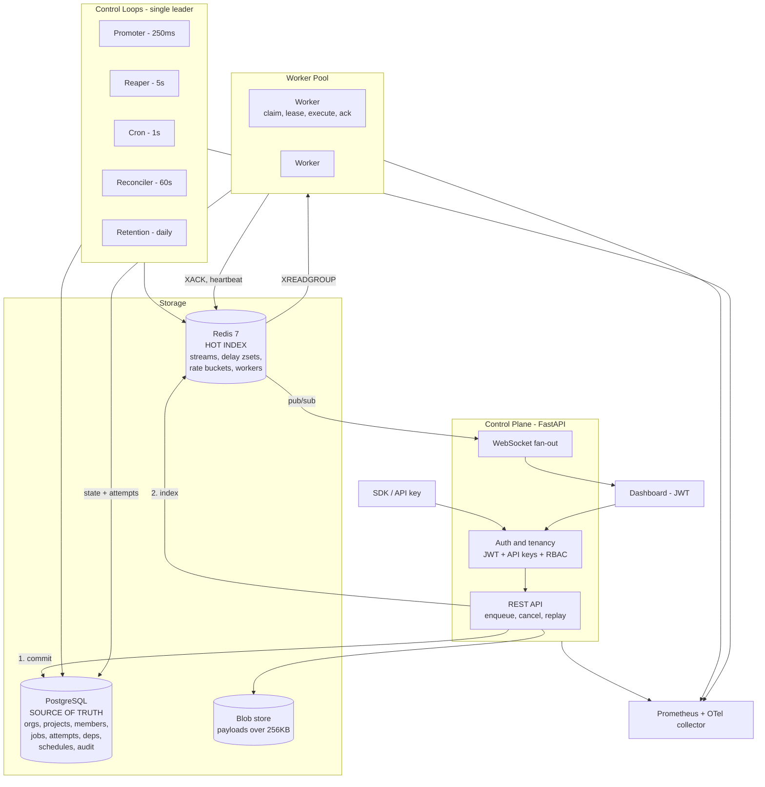

# RELAY — Architecture

Self-hosted distributed job queue. **Postgres is the source of truth. Redis is a rebuildable index.**

This document describes the target design. Today only the control plane, Postgres, the Redis stream producer, and local blob storage run. Workers, control loops, the WebSocket fan-out, and telemetry export are planned. See the [current implementation handbook](docs/current-implementation-handbook.md) for what exists now.

---

## Component diagram

---

## Layer responsibilities

| Layer | Owns | Never does |
|---|---|---|
| **Control plane** | Auth, tenancy, validation, enqueue, reads, WebSocket fan-out | Execute jobs, run control loops |
| **Postgres** | Tenancy, job state, attempt history, DAG edges, schedules, audit | Serve the dispatch hot path |
| **Redis** | Dispatch transport, delay sets, rate buckets, worker registry | Hold anything that can't be rebuilt |
| **Control loops** | Promotion, reclaim, cron firing, drift repair, retention | Run on more than one process at a time |
| **Workers** | Claim, lease renewal, execute, report outcome | Decide policy — they read it from the job |
| **Dashboard** | Read-only views plus operator actions | Talk to Redis or Postgres directly |

---

## The write path, in order

1. **Client enqueues** through the control plane with an API key.
2. **Idempotency key is claimed** in a small unpartitioned table.
3. **Oversized payload is offloaded** to blob storage, and the row keeps a reference.
4. **Job row is committed to Postgres.** The job is now durable — everything after this is recoverable.
5. **Redis is indexed** with a stream entry or a delay-set entry. If this step fails, the API still returns `201` with `indexed: false`, because the job is durable, and the reconciler repairs the index. Delay-set writes and the reconciler are planned.
6. **A worker reads** the entry through a consumer group, which leaves it pending until acknowledged. This is only a transport claim.
7. **The worker claims the row** with a conditional Postgres update from `queued` to `running`. Only the winner runs the handler. It then holds a lease and extends it on every heartbeat.
8. **Terminal outcome writes to Postgres,** fenced on owner and attempt, then the stream entry is acknowledged.

---

## The five control loops

Only one process runs these at a time, elected by a Postgres advisory lock. If it dies, its connection drops and the lock releases automatically.

| Loop | Interval | Purpose | Cost of not having it |
|---|---|---|---|
| **Promoter** | 250 ms | Move due delay-set entries into live streams | Retries and scheduled jobs never run |
| **Reaper** | 5 s | Reclaim expired leases, park repeat offenders, fix counters | A crashed worker's jobs stall forever |
| **Cron** | 1 s | Fire due schedules, compute next run | No recurring jobs |
| **Reconciler** | 60 s | Repair Postgres-to-Redis drift both ways | Silent drift after any Redis incident |
| **Retention** | daily | Roll partitions, archive, sweep dedupe keys | Table bloat, dashboard slows to a crawl |

---

## Redis key layout

Queue names are unique only inside a project, so every queue key includes the project id. All keys are defined in `packages/redis/src/relay_redis/keys.py`.

| Key shape | Type | Purpose | Status |
|---|---|---|---|
| `q:{project}:{queue}:p0..p3` | Stream | Live work, one per priority lane | Producer built |
| `q:{project}:{queue}:paused` | String | Pause flag | Built |
| `queue:cfg:{project}:{queue}` | Hash, short TTL | Cached queue defaults | Built |
| `purge:token:{project}:{queue}` | String, short TTL | Purge confirmation hash | Built |
| `ratelimit:login:*`, `ratelimit:apikey:*` | Counter | Authentication abuse limits | Built |
| `q:{project}:{queue}:delayed` | Sorted set | Retries, throttled jobs, scheduled jobs | Planned |
| `q:{project}:{queue}:rl` | Hash | Token bucket state | Planned |
| `workers` | Sorted set | Heartbeat times, for liveness and diagnostics. The Postgres lease decides reclaim. | Planned |
| `events:{project}` | Pub/Sub | Feeds the dashboard WebSocket | Planned |

Dispatch state is derivable from Postgres, and the rest is short-lived. That is the whole point.

---

## Scaling axes

| Pressure | Response |
|---|---|
| More throughput | Add worker processes — stateless, horizontally scalable |
| More enqueue load | Add control-plane replicas behind a load balancer |
| Postgres write pressure | Batch attempt writes, move history reads to a read replica |
| Redis memory | Backlog admission through `max_depth`, trimming only entries safe to remove, and payload offload; sharding by project is the v2 path |
| Table growth | Monthly partitions, detach and archive rather than delete |

**Deliberately single-region and single-Redis for v1.** Sharding has a documented plan; it is not built.
